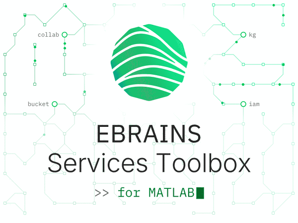

<a href="/resources/images/toolbox_logo_light.gif">
  <picture>
    <source media="(prefers-color-scheme: dark)" srcset="/resources/images/toolbox_logo_dark.gif">
    <source media="(prefers-color-scheme: light)" srcset="/resources/images/toolbox_logo_light.gif">
    
  </picture>
</a>

# EBRAINS Services Toolbox for MATLAB

[](https://github.com/ehennestad/EBRAINS-MATLAB/releases/latest)
[](https://se.mathworks.com/matlabcentral/fileexchange/182284-ebrains-services-toolbox)
[](https://github.com/ehennestad/EBRAINS-MATLAB/actions/workflows/test-code.yml)
[](https://codecov.io/gh/ehennestad/EBRAINS-MATLAB)
[](https://github.com/ehennestad/EBRAINS-MATLAB/security/code-scanning)
[](https://github.com/ehennestad/EBRAINS-MATLAB/actions/workflows/run-codespell.yml)
[](https://gitHub.com/ehennestad/EBRAINS-MATLAB/graphs/commit-activity)


Lightweight MATLAB helpers and API clients for working with EBRAINS services: authentication, Data Proxy buckets, the Knowledge Graph (KG), and the Collaboratory.

## Features
- Authenticate to EBRAINS using the **device flow** or the **client credentials flow**
- List, upload, download, rename, and delete objects in Data Proxy buckets, and compute bucket sizes
- Sync a local folder to a bucket, or a bucket to a local folder, sending only new and changed files
- Read, create, update, release, and delete Knowledge Graph instances, and run dynamic queries
- Search collabs through the Collaboratory API

## Requirements
- MATLAB R2022b or newer. The virtual bucket browser (`ebrains.bucket.app.VirtualBucketBrowser`) needs R2023a or newer; the functions work on R2022b.
- An EBRAINS account and internet access

## Installation
Download the `.mltbx` file from the [latest release](https://github.com/ehennestad/EBRAINS-MATLAB/releases/latest) and open it in MATLAB, or install the toolbox from the [Add-On Explorer](https://se.mathworks.com/matlabcentral/fileexchange/182284-ebrains-services-toolbox).

To use the source directly, clone the repo and add `src/` to your MATLAB path:

```matlab
addpath(genpath(fullfile(pwd, "src")))
savepath  % optional
```

## Quick start

### 1) Log in
```matlab
ebrains.login()
```
This opens a browser window that redirects to the EBRAINS login page. Scripts and CI jobs can use the client credentials flow instead. Read the secret from an environment variable of your choice rather than typing it in: MATLAB keeps what is typed in the Command Window in its command history.

```matlab
ebrains.login(OAuthFlow="ClientCredentialsFlow", ...
    OIDCClientID="my-client", OIDCClientSecret=getenv("EBRAINS_CLIENT_SECRET"))
```
`ebrains.logout()` removes the tokens held in the MATLAB session.

> [!TIP]
> You can also provide an access token via the environment variable `EBRAINS_TOKEN`. See [Running without a display](#running-without-a-display) for how it is used.

### 2) Work with Data Proxy buckets
List objects and compute the total size of a bucket:
```matlab
objects = ebrains.bucket.listBucketObjects("my-bucket", Verbose=true);
bytes = ebrains.bucket.getBucketSize("my-bucket");
fprintf("Objects: %d, Size: %.2f GB\n", numel(objects), double(bytes)/1e9);
```

Upload, download, and delete files:
```matlab
ebrains.bucket.uploadFile("my-bucket", "results/summary.csv", "summary.csv");
ebrains.bucket.downloadFile("my-bucket", "results/summary.csv", "summary_copy.csv");
ebrains.bucket.deleteObject("my-bucket", "results/summary.csv");
```

Sync a whole folder, the way rsync does: only new and changed files are sent, so a sync that is interrupted picks up where it stopped when run again. `Delete=true` also deletes what the source does not have, which makes the target an exact mirror, and `DryRun=true` shows the plan without changing anything:
```matlab
% Make the "results" folder of the bucket match the local folder
ebrains.bucket.sync.toBucket("results", "my-bucket", Prefix="results", Delete=true, DryRun=true);
ebrains.bucket.sync.toBucket("results", "my-bucket", Prefix="results", Delete=true);

% Make a local folder match the bucket
actions = ebrains.bucket.sync.fromBucket("my-bucket", "data", Exclude=["*.tmp", ".git"]);
```

A virtual bucket is a local folder that stands for a bucket, with an empty placeholder for each file that is online only. The browser opens on the list of your virtual buckets, where a bucket can be given a label in place of its name and pinned to the top, and makes a new one from a bucket name alone once a root folder is set:
```matlab
ebrains.bucket.setVirtualBucketRoot("~/EBRAINS buckets");
ebrains.bucket.app.VirtualBucketBrowser();                 % the list of virtual buckets
ebrains.bucket.app.VirtualBucketBrowser("temp_data");      % one virtual bucket
rows = ebrains.bucket.listVirtualBuckets();                % the list as a table
```
The list is kept in `virtual-buckets.json` in the configuration folder of the user, shared with the [ebrains-bucket-sync](https://github.com/ehennestad/ebrains-bucket-sync) package: `~/Library/Application Support/ebrains-bucket-sync` on macOS, `%LOCALAPPDATA%\ebrains-bucket-sync` on Windows and `~/.config/ebrains-bucket-sync` elsewhere, or the folder `EBRAINS_BUCKET_SYNC_CONFIG_DIR` names.

### 3) Download Knowledge Graph metadata
```matlab
kgClient = ebrains.kg.api.InstancesClient();
instance = kgClient.getInstance("08ab00ea-3e19-4300-9d9f-c0ef0ec8e445");
```
Lookups default to the `RELEASED` stage. Pass a stage vector in order of preference to fall back to unreleased drafts:
```matlab
instance = kgClient.getInstance(identifier, ["RELEASED", "IN_PROGRESS"]);
```

### 4) Search collabs
```matlab
collabClient = ebrains.collab.api.CollabsClient();
collabs = collabClient.searchCollabs(limit=50);
```

More complete examples are in [`src/ebrains/examples`](src/ebrains/examples).

## Running without a display
Scheduled jobs and CI runners have no browser to log in with and no screen for progress dialogs. Three settings cover that:

- **`EBRAINS_TOKEN`** holds an access token to use instead of logging in. It is used while it is valid. The toolbox cannot renew it, so once it expires, requests fall back to logging in with the device flow.
- **`EBRAINS_MATLAB_FORCE_CLIENT_CREDENTIALS_OAUTH_FLOW`** set to `"true"` makes that fallback an error instead: when there is neither a client credentials login nor a valid `EBRAINS_TOKEN`, an unattended job fails rather than waits for a browser login nobody will complete.
- **`DisplayMode="Command Window"`**, an option of `ebrains.bucket.uploadFile` and `ebrains.bucket.downloadFile`, prints transfer progress instead of opening a dialog.

## See Also
### [openMINDS KG Sync](https://github.com/ehennestad/openminds-kg-sync)
A MATLAB toolbox that builds upon the EBRAINS MATLAB KG API to provide high-level functions for synchronizing [openMINDS](https://openminds.docs.om-i.org/en/latest/) metadata to and from the [EBRAINS Knowledge Graph](https://docs.kg.ebrains.eu). It offers convenient methods like `kglist`, `kgpull`, and `kgsave` for working with [openMINDS metadata types](https://github.com/openMetadataInitiative/openMINDS_MATLAB), handling serialization and deserialization of instances. If you need to work with structured neuroscience metadata using the openMINDS standard, this toolbox provides a streamlined interface on top of the lower-level `ebrains.kg.api.InstancesClient` functionality.

## Contributing
- Open an issue to discuss ideas/bugs.
- Fork, create a feature branch, add tests where practical, and open a PR.

See [CONTRIBUTING.md](.github/CONTRIBUTING.md) for how to run the tests.

## License
Released under the [MIT License](LICENSE). The bundled transfer package in [`src/ebrains/external/+ebrains/+external/+webprogress`](src/ebrains/external/+ebrains/+external/+webprogress) is distributed under its own MIT License, in the `LICENSE` file beside it, whose notice has to be kept with any copy of that package.

## Acknowledgements
The Device Flow authentication was inspired by and modified from:
https://github.com/xgui3783/ebrains-iam-util/tree/main
